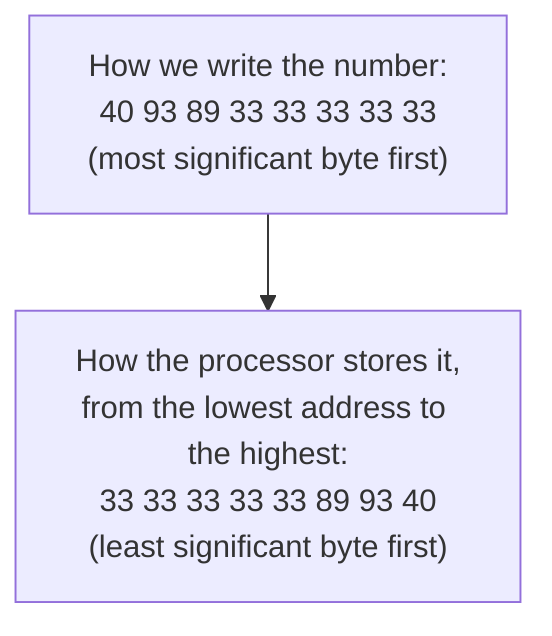
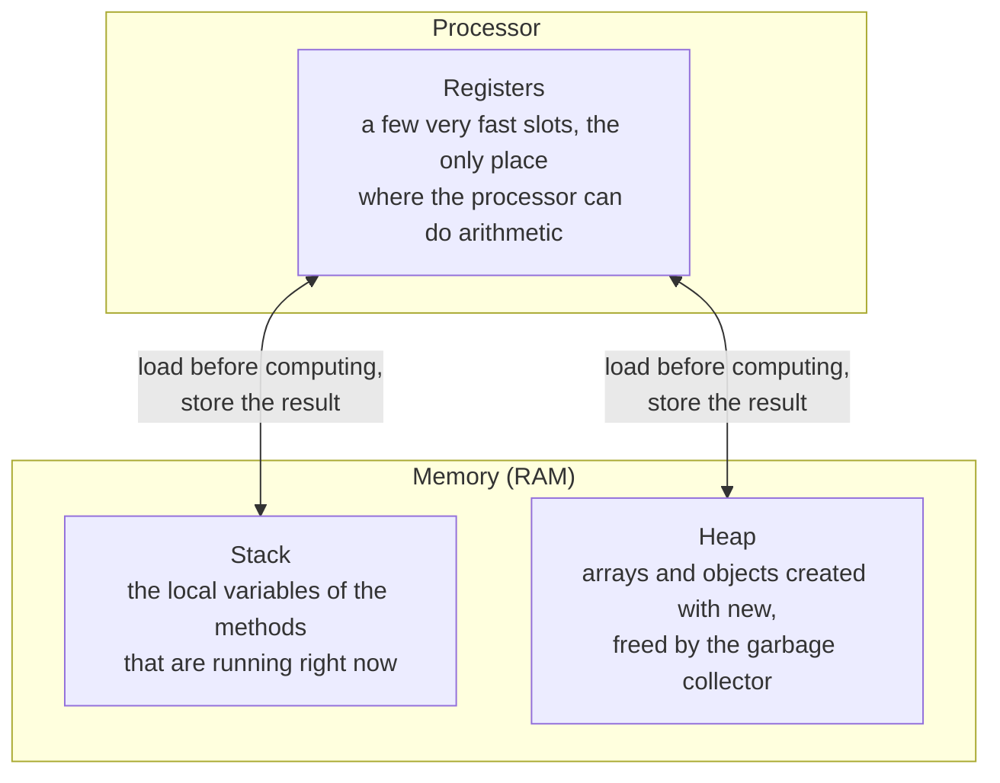
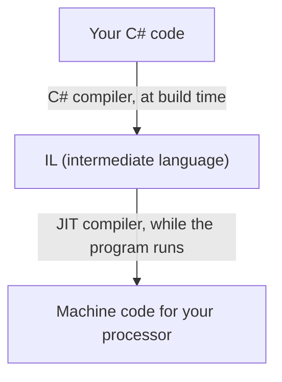
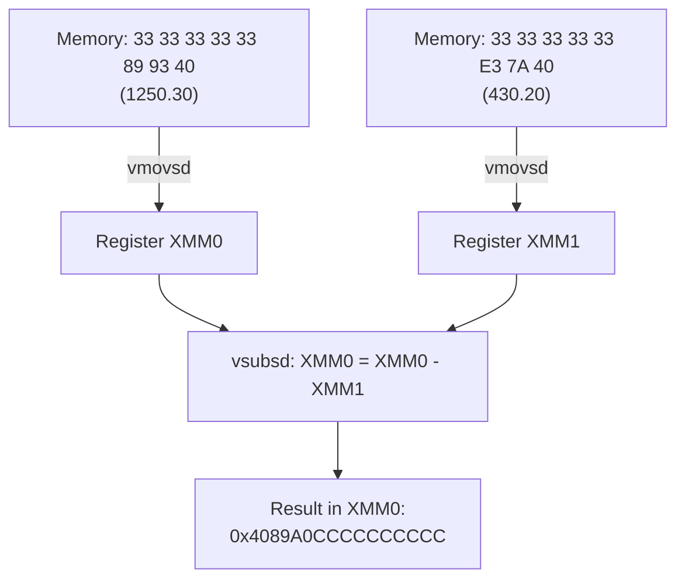
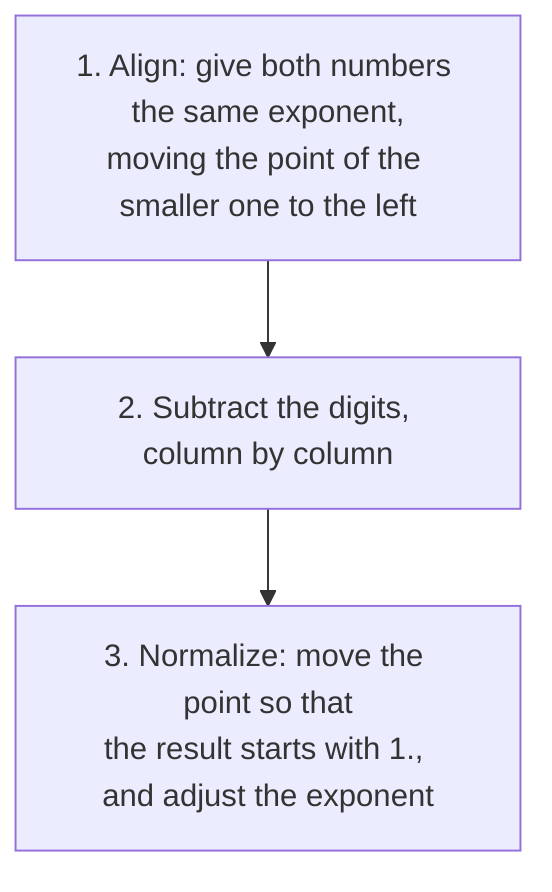
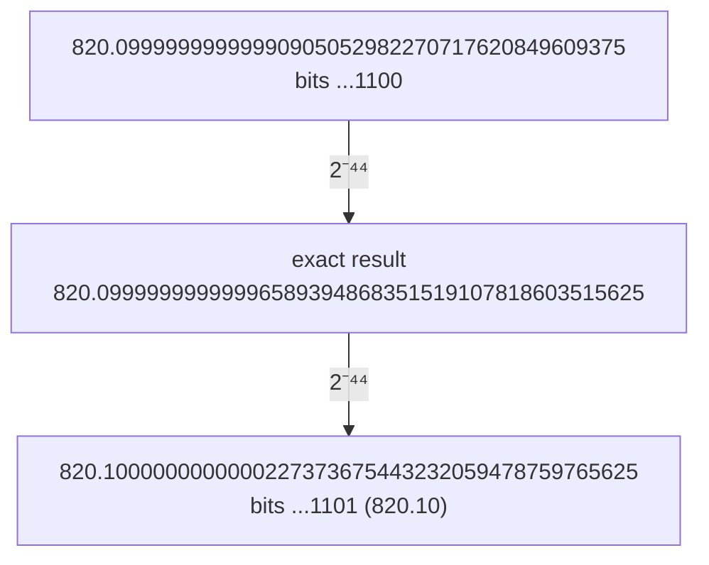
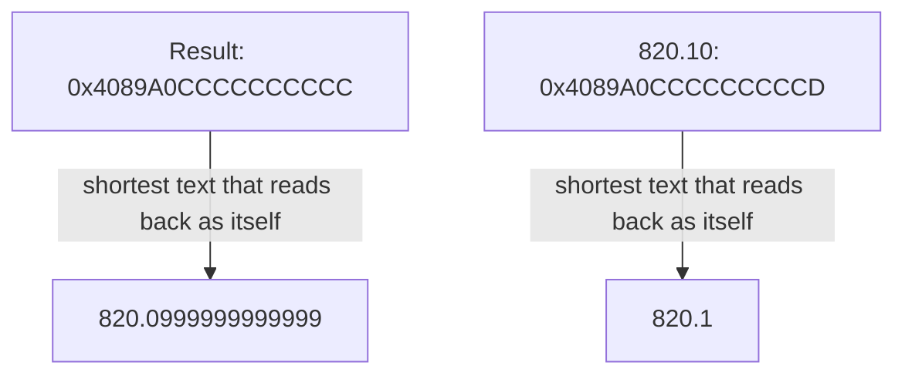
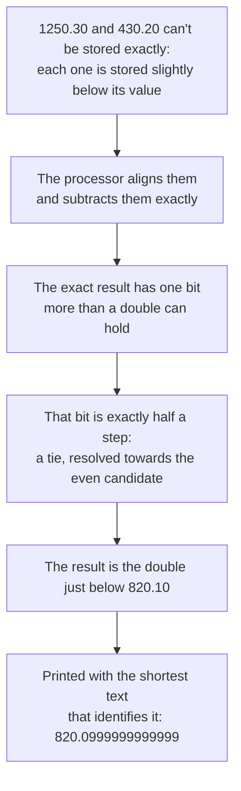
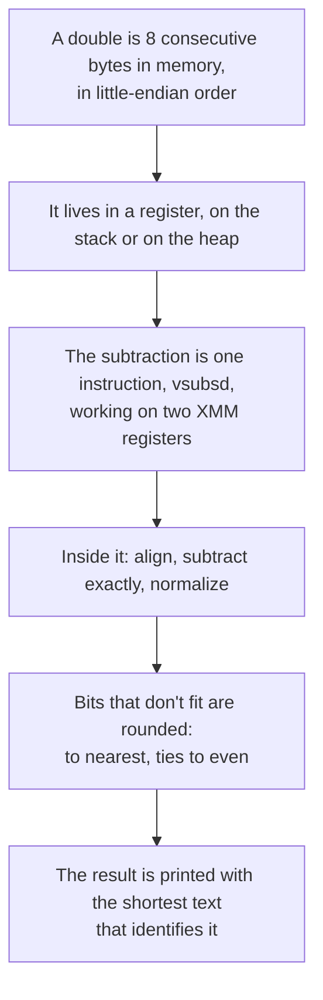

# Appendix B: Floating point inside the machine

| Prerequisites | Time |
|---------------|------|
| [Appendix A](A-numbers-in-binary.md) | about 40 minutes |

This appendix follows the number 1250.30 physically: how its bytes sit in memory, how the processor works on them, and what happens, bit by bit, when it computes `1250.30 - 430.20` and gets `820.0999999999999`.

## 1. A double in memory: 8 bytes in a row

The memory of a computer (the RAM) is a very long row of bytes. Every byte has a number that identifies it, its address, just like every house in a street has a house number. Addresses are usually written in hexadecimal ([appendix A](A-numbers-in-binary.md#3-bits-bytes-and-hexadecimal) explains how to read it).

A `double` takes 8 bytes, and they are always 8 consecutive bytes. To see them, we can ask C# for the address of a variable and read the memory one byte at a time:

```csharp
unsafe
{
    double amount = 1250.30;
    byte* address = (byte*)&amount;     // &amount: the address of the variable

    for (var i = 0; i < 8; i++)
        Console.WriteLine($"0x{(ulong)(address + i):X16}   {address[i]:X2}");
}
```

`&amount` gives the address where `amount` is stored, and `byte*` lets us read the memory starting from there, one byte at a time. C# normally doesn't allow this kind of direct access to memory, which is why the code has to be marked `unsafe`.

This is the output on my machine:

| Address | Byte |
|---|---|
| 0x000000661F77EDA8 | 33 |
| 0x000000661F77EDA9 | 33 |
| 0x000000661F77EDAA | 33 |
| 0x000000661F77EDAB | 33 |
| 0x000000661F77EDAC | 33 |
| 0x000000661F77EDAD | 89 |
| 0x000000661F77EDAE | 93 |
| 0x000000661F77EDAF | 40 |

The addresses change every time the program runs, because the operating system decides where to place it in memory. What doesn't change is that the 8 bytes are next to each other, and their content. You can run the same code with `dotnet run --project experiments/DoubleInMemory` (see [Program.cs](../experiments/DoubleInMemory/Program.cs)) and you'll see different addresses with the same bytes.

In appendix A we wrote the 64 bits of 1250.30 in hexadecimal as `0x4093893333333333`. Split into bytes, that's `40 93 89 33 33 33 33 33`. In memory they're the same bytes, but in the opposite order:



This order is called little-endian: the "little end" of the number, its least significant byte, goes first, at the lowest address. The processors in today's PCs, servers and phones (x64 and ARM) all work this way. It's a design choice, a bit like writing a number starting from the units. In C#, `BitConverter.IsLittleEndian` tells you whether the machine you're running on works this way, and `BitConverter.GetBytes(1250.30)` gives the same 8 bytes in memory order without any `unsafe` code: `33-33-33-33-33-89-93-40`.

### Stop and think

In which byte, and at which address, are the sign bit and the beginning of the exponent?

<details>
<summary>Answer</summary>

In the byte with the highest address, `0x40`. In appendix A the sign and the exponent are the first bits of the number, and the first byte when we write it is the last one in memory. `0x40` is 0100 0000 in binary: the first bit, 0, is the sign (positive), and the other seven are the first seven bits of the exponent, 1000000. The last four bits of the exponent, 1001, are in the next byte down, `0x93` = 1001 0011. Together they give 10000001001, the exponent of 1250.30 from appendix A.

</details>

## 2. Where the number lives: registers, stack and heap

A `double` doesn't always live in the same kind of place. There are three, and the number moves between them while the program runs:



**Registers** are small storage slots inside the processor itself. They're much faster than memory, but there are very few of them: on an x64 processor, the ones used for floating point numbers are 16, called XMM0 to XMM15. The processor can only add or subtract values that are in registers, so every calculation starts by loading the numbers from memory into registers and ends by storing the result back. When it can, the compiler keeps a local variable in a register for its whole life and never writes it to memory at all.

**The stack** holds the local variables of the methods that are running. Each method call gets its own area, which is freed automatically when the method returns. Taking the address of a variable with `&`, as in section 1, forces it out of a register and into the stack, because a register has no address.

**The heap** holds arrays and objects. They stay there until the garbage collector frees them, when nothing refers to them any more. A `double` inside an array or inside an object is stored right there, in the memory of that array or object.

This is a real run on my machine, printing the addresses of a few doubles:

| What | Address |
|---|---|
| a local variable | 0x0000003958F7EBA8 |
| another local variable | 0x0000003958F7EB90 |
| `amounts[0]`, in a `double[]` | 0x0000013B6A49D4B0 |
| `amounts[1]` | 0x0000013B6A49D4B8 |
| the `Amount` field of an object | 0x0000013B6A49D4D0 |

The two areas are easy to tell apart: the local variables are in one region of memory (the stack), the array and the object in another (the heap). The elements of the array are exactly 8 bytes apart, one `double` after the other. The `DoubleInMemory` experiment prints these addresses too, so you can compare them with yours.

The two local variables are close to each other, but their order is chosen by the compiler. What is fixed on x64 is the direction in which the stack grows: each new method call takes its area below the previous one, at lower addresses.

### Stop and think

`var amounts = new double[1000];` How many bytes do the 1,000 numbers take, and where are they?

<details>
<summary>Answer</summary>

8,000 bytes, 8 for each `double`, all in a row on the heap. The array also has a small header in front of the elements, with information such as its length, but the numbers themselves are 8,000 consecutive bytes.

</details>
## 3. The instruction that does the subtraction

The processor doesn't run C#. When you build a project, the C# compiler translates your code into an intermediate language (IL), and when the program runs, .NET's JIT compiler (just in time) translates the IL into machine code for the processor you're using. .NET can show you that machine code if you set the environment variable `DOTNET_JitDisasm` to the name of a method.



Here's a method that subtracts two doubles. `NoInlining` stops the JIT from copying the method into its caller, so that we can see it on its own:

```csharp
[MethodImpl(MethodImplOptions.NoInlining)]
static double Subtract(double total, double invoice) => total - invoice;

Console.WriteLine(Subtract(1250.30, 430.20));   // 820.0999999999999
```

This is the machine code that calls it, as printed by .NET 10 on an x64 processor:

```
vmovsd   xmm0, qword ptr [...]      ; the constant 0x4093893333333333 (1250.30)
vmovsd   xmm1, qword ptr [...]      ; the constant 0x407AE33333333333 (430.20)
call     Subtract
```

`vmovsd` means "move a scalar double": it copies 8 bytes from memory into a register. The two constants are exactly the bits of 1250.30 and 430.20 from appendix A. On x64 the first two `double` arguments of a method travel in the registers XMM0 and XMM1, and the result comes back in XMM0.

And this is the whole `Subtract` method:

```
vsubsd   xmm0, xmm0, xmm1           ; xmm0 = xmm0 - xmm1
ret                                 ; return: the result is in xmm0
```

The subtraction is a single instruction, `vsubsd`, "subtract a scalar double". The method takes 5 bytes of machine code in total.



### A trap: subtracting two constants

If you write the subtraction with two constants, the processor doesn't subtract anything:

```csharp
static double Folded() => 1250.30 - 430.20;
```

```
vmovsd   xmm0, qword ptr [...]      ; the constant 0x4089A0CCCCCCCCCC
ret
```

The C# compiler calculated the result while building the project, because `1250.30 - 430.20` is a constant expression, and wrote only the result into the program. It follows the same rules as the processor, so the result is the same, `0x4089A0CCCCCCCCCC`. That's why, to see the real subtraction, you need two variables or two parameters.

One detail: next to that constant, the listing shows the comment `; 820.1`. The tool rounds the number to make it readable, but the bits end in `CCCC`, while 820.10 is `...CCCD`. They are two different doubles, as the next sections show.

### See it yourself

The [SubtractionInCpu](../experiments/SubtractionInCpu/Program.cs) project contains both methods. To see their machine code, run it in Release with two environment variables. In PowerShell:

```powershell
$env:DOTNET_JitDisasm = "*Subtract* *Folded*"; $env:DOTNET_TieredCompilation = "0"
dotnet run -c Release --project experiments/SubtractionInCpu
```

In bash:

```bash
DOTNET_JitDisasm="*Subtract* *Folded*" DOTNET_TieredCompilation=0 dotnet run -c Release --project experiments/SubtractionInCpu
```

`DOTNET_JitDisasm` prints the machine code of the methods whose name matches; the asterisks are needed because the compiler adds characters to the names of methods declared in `Program.cs`. `DOTNET_TieredCompilation=0` makes the JIT produce the optimized code straight away: by default it first generates a quick, unoptimized version, and the listing would appear twice.

### Stop and think

In the `Folded` version, when and where does the subtraction happen?

<details>
<summary>Answer</summary>

On the machine that builds the project, when the C# compiler runs. The program that ships contains only the result, and the processor that runs it just loads it into XMM0.

</details>
## 4. Inside the subtraction: align, subtract, normalize

You can't subtract two numbers in scientific notation digit by digit if their exponents are different. Try it in base 10 with 1250.3 = 1.2503 × 10³ and 430.2 = 4.302 × 10²: subtracting 1.2503 - 4.302 makes no sense, because the digits are worth different amounts. First you rewrite the smaller number with the same exponent as the bigger one, moving its point one place to the left: 4.302 × 10² = 0.4302 × 10³. Now the digits line up:

```
  1.2503 × 10³
- 0.4302 × 10³
= 0.8201 × 10³  = 8.201 × 10²
```

The result starts with 0, so it's normalized again: the point moves one place to the right and the exponent goes down by one. The processor does exactly these three steps, in base 2:



**1. Align.** From appendix A, 1250.30 is 1.0011100010...₂ × 2¹⁰ and 430.20 is 1.1010111000...₂ × 2⁸. The exponents differ by 2, so the point of 430.20 moves two places to the left: 1.1010111000...₂ × 2⁸ = 0.011010111000...₂ × 2¹⁰. Moving the point pushes its last two bits beyond the 52 bits that 1250.30 has after the point. The IEEE 754 standard requires the processor to give the same result it would get by computing exactly and rounding only at the end, so those two bits aren't thrown away: the hardware keeps a few extra bits for this purpose. On the 1250.30 side, the two extra positions are simply 0.

**2. Subtract.** In base 2, column subtraction follows the same rules as in base 10, with only two digits: 1 - 0 = 1, 1 - 1 = 0, 0 - 0 = 0, and 0 - 1 gives 1 with a borrow of 1 from the column on the left (just as 0 - 1 in base 10 gives 9 with a borrow). For example, 1000₂ - 0011₂ = 0101₂, which is 8 - 3 = 5. These are the real bits of the subtraction, all multiplied by 2¹⁰:

```
  1.001110001001001100110011001100110011001100110011001100   1250.30, with two 0s at the end
- 0.011010111000110011001100110011001100110011001100110011   430.20, moved 2 places to the right
= 0.110011010000011001100110011001100110011001100110011001   the exact difference
```

In decimal, this exact difference is 820.09999999999996589394868351519107818603515625: the difference between the two values really stored (1250.2999999999999545... and 430.1999999999999886..., from appendix A).

**3. Normalize.** The result starts with 0., because 820 is less than 1024 = 2¹⁰. The point moves one place to the right and the exponent goes from 10 to 9:

```
0.110011010000011001100110011001100110011001100110011001 × 2¹⁰
= 1.10011010000011001100110011001100110011001100110011001 × 2⁹
```

Now count the bits after the point: there are 53, but a double has room for only 52. One bit is left over, the last one, and it's a 1:

```
1.1001101000001100110011001100110011001100110011001100 | 1
  └──────────────── 52 bits that fit ───────────────┘   └ 1 bit too many
```

The processor has to get rid of it, and how it does that decides the final result.

### Stop and think

Why couldn't the processor just subtract the 52 fraction bits of 430.20 from the 52 fraction bits of 1250.30, as they're stored?

<details>
<summary>Answer</summary>

Because they have different exponents (2¹⁰ and 2⁸), so bits in the same position are worth different amounts, just like 1.2503 × 10³ and 4.302 × 10² in base 10. Before subtracting, the numbers have to be written with the same exponent.

</details>

## 5. Rounding the bit that doesn't fit

The exact result has one bit more than a double can hold, so the processor has to choose between two doubles: keep the 52 bits as they are and drop the extra one, or add 1 to the last of the 52 bits.

| Choice | Last bits | Value |
|--------|-----------|-------|
| keep the 52 bits | `...1100` | 820.09999999999990905052982270717620849609375 |
| add 1 to the last bit | `...1101` | 820.1000000000000227373675443232059478759765625 |

The second one is exactly the double you get when you write `820.10`. They're neighbors: as appendix A explains, around 820 two consecutive doubles are 2⁻⁴³ apart, and nothing exists in between.

Where does the exact result fall between them? The extra bit is a 1 with nothing after it, so it's worth exactly half of the last bit that fits. The exact result is therefore exactly halfway between the two candidates, 2⁻⁴⁴ from each:



The IEEE 754 standard decides how to round, and its default rule is called "round to nearest, ties to even": choose the nearest candidate, and when the result is exactly halfway, choose the one whose last bit is 0. The processor decides by looking at the bits that don't fit:

| Bits that don't fit | Compared with half a step | Result |
|---------------------|---------------------------|--------|
| start with 0 | less than half | keep the 52 bits (round down) |
| a 1, followed by at least one more 1 | more than half | add 1 (round up) |
| a 1, followed only by 0s | exactly half | the candidate ending in 0 |

Our leftover is a single 1: exactly half. The candidate ending in 0 is the first one, `...1100`, so the processor keeps the 52 bits and the result is `0x4089A0CCCCCCCCCC`, about 820.0999999999999.

Why "to even", instead of always rounding halfway values up, as at school? If halfway values always went up, a long series of calculations would slowly drift upwards. Going to the even candidate sends about half of the ties up and half down, so the small errors tend to cancel out.

To make this decision the processor doesn't need to keep all the extra bits: it's enough to know the first bit that doesn't fit, and whether any 1 comes after it. That's why the hardware gets by with only three extra bits, called guard, round and sticky. The first two are the bits right after the last one that fits (two are needed, because normalizing can bring one of them back in, as happened here), and the sticky bit simply records whether any 1 was pushed out beyond them.

### Stop and think

If the bits that didn't fit had been `11` instead of `1`, what would the result have been?

<details>
<summary>Answer</summary>

`11` is more than half a step, so the processor would have rounded up, to `...1101`: exactly the double of 820.10. In that case `1250.30 - 430.20 == 820.10` would have been true. The result depends on the very last bits of the two numbers.

</details>

## 6. Back to 820.0999999999999

Now everything is in place. These are the result and the double you get by writing 820.10, side by side:

| | Bits | Exact value |
|---|---|---|
| `1250.30 - 430.20` | `0x4089A0CCCCCCCCCC` | 820.09999999999990905052982270717620849609375 |
| `820.10` | `0x4089A0CCCCCCCCCD` | 820.1000000000000227373675443232059478759765625 |

They differ only in the very last bit. They are two different doubles, so `1250.30 - 430.20 == 820.10` is false.

The last question is why one of them is printed as `820.1` and the other as `820.0999999999999`. When .NET turns a double into text, it writes the shortest text that, read back, gives exactly the same double. For the second one, `820.1` is enough: `double.Parse("820.1")` gives back `...CCCD`. For our result, `820.1` would identify the wrong double, so more digits are needed, and the shortest text that identifies `...CCCC` is `820.0999999999999`. With one digit less, `820.099999999999`, you'd get yet another double.



So `820.0999999999999` isn't a printing mistake: it's the shortest correct name of the double the processor produced. If you want to see more digits, `result.ToString("G17")` prints 17 significant digits: `820.09999999999991`.

The whole story, from the beginning:



### Stop and think

Is `Math.Abs((1250.30 - 430.20) - 820.10) < 1e-9` true or false?

<details>
<summary>Answer</summary>

True: the two doubles are one step apart, 2⁻⁴³, about 0.000000000000114, which is much less than 0.000000001. That's why, when two doubles come from calculations, they're usually compared with a small tolerance instead of `==`.

</details>

## 7. Try it

The [SubtractionInCpu](../experiments/SubtractionInCpu/Program.cs) project prints all the steps of this appendix, bit by bit:

```bash
dotnet run -c Release --project experiments/SubtractionInCpu
```

```
Aligned (× 2^10):
  1.001110001001001100110011001100110011001100110011001100   1250.30
- 0.011010111000110011001100110011001100110011001100110011   430.20
= 0.110011010000011001100110011001100110011001100110011001

Normalized (× 2^9):
  1.10011010000011001100110011001100110011001100110011001
  52 bits that fit: 1001101000001100110011001100110011001100110011001100
  bits left over:   1

Result bits: 0x4089A0CCCCCCCCCC   exact value 820.09999999999990905052982270717620849609375
820.10 bits: 0x4089A0CCCCCCCCCD   exact value 820.1000000000000227373675443232059478759765625
```

The steps are computed by [SubtractionTrace](../src/Algorithms/Appendix/SubtractionTrace.cs), and its [tests](../tests/Algorithms.Tests/Appendix/SubtractionTraceTests.cs) check every bit and every number quoted in this appendix, including the fact that the exact result is exactly halfway between the two candidates.

## Quick check

**1.** After `vsubsd xmm0, xmm0, xmm1`, where is the result?

<details>
<summary>Answer</summary>

In the register XMM0, which is also where a method returns a `double` on x64.

</details>

**2.** Why does the C# compiler, computing `1250.30 - 430.20` at build time, get exactly the same bits as the processor?

<details>
<summary>Answer</summary>

Because both follow the same rules, those of the IEEE 754 standard: the same alignment, the same exact subtraction and the same "round to nearest, ties to even".

</details>

**3.** The result and 820.10 differ only in the last bit. How far apart are they, in value?

<details>
<summary>Answer</summary>

One step between consecutive doubles around 820: 2⁻⁴³, about 0.000000000000114.

</details>

**4.** When the exact result is exactly halfway between two doubles, which one does the processor choose?

<details>
<summary>Answer</summary>

The one whose last bit is 0, the "even" one. In our case it's the one just below 820.10.

</details>

## Summary



[Back to the appendix index](README.md)